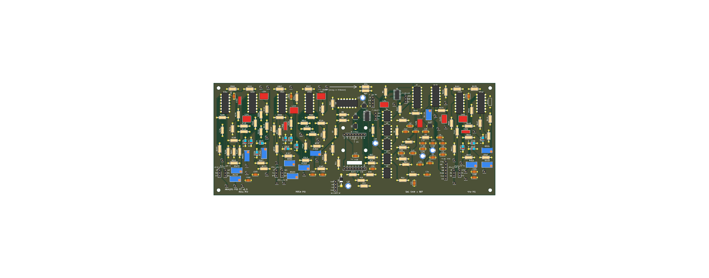
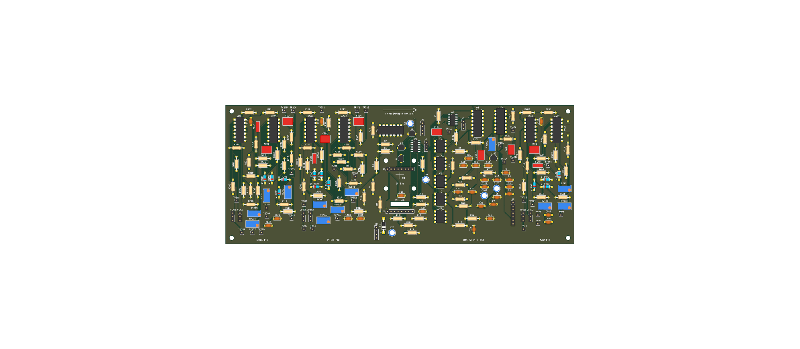

# Old PID_Board (through-hole) versions

These are superseded. The current board is in the parent folder (`PID_Board/`, rev B). See
[`../../CHANGELOG.md`](../../CHANGELOG.md) for what changed.

| Folder | Version | Board | Contents |
|---|---|---|---|
| `revA_250x100_2026-10-25/` | Rev A (tag `pid-tht-rev-a`) | 250 x 100 mm, 2-layer | `.kicad_pcb`, renders, Gerbers + drill zip, grouped BOM, CPL, STEP, known issues |
| `v1_250x100_2026-10-20/` | v1 (tag `pid-tht-v1`) | 250 x 100 mm, 2-layer | `.kicad_pcb`, renders, Gerbers (+ zip), BOM, STEP |

Each `.kicad_pcb` here is a snapshot of the board file at that tag. To open one with its matching
schematics, check out the tag (for example `git checkout pid-tht-rev-a`), or copy the file into a project folder next to the
schematic sheets of that version.

## Rev A

## v1

