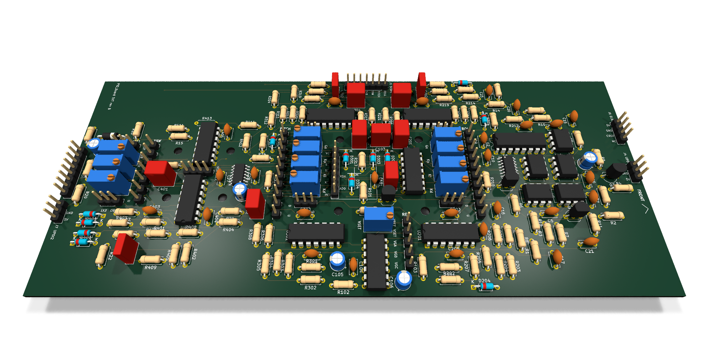
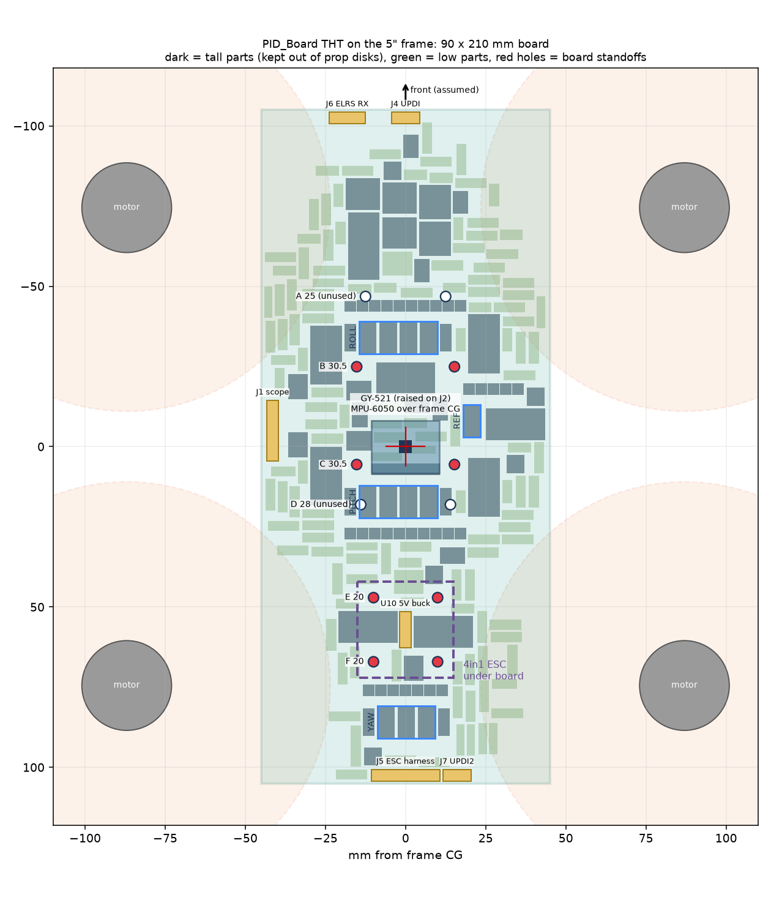
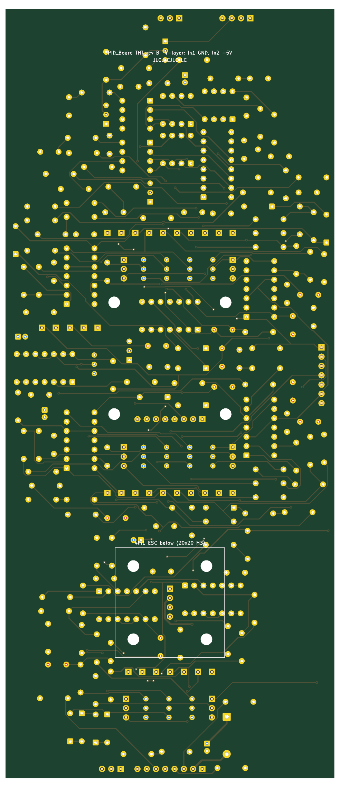
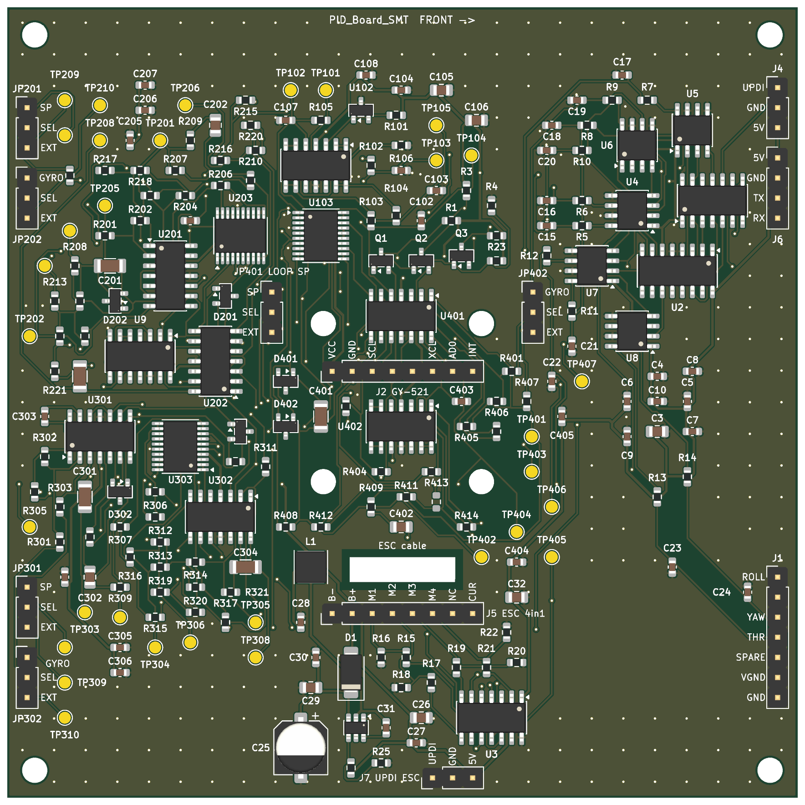
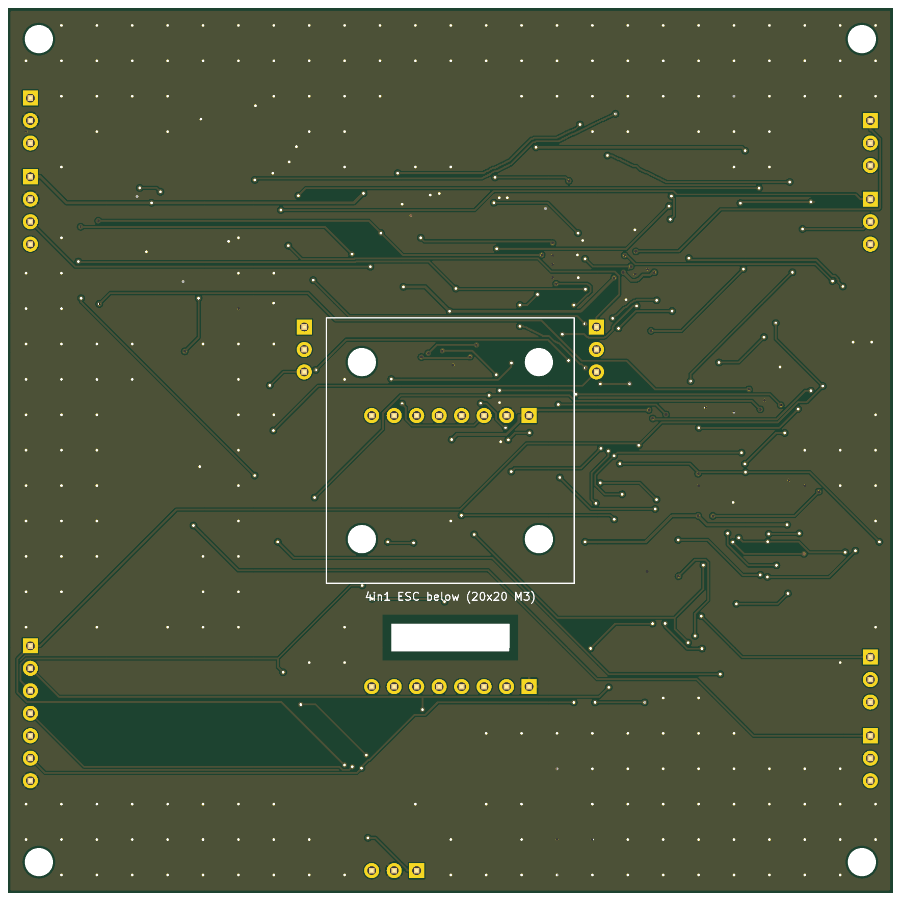

# Quadcopter Flight Controller – Analog PID Boards

Analog PID flight controller for a 5" quadcopter: roll, pitch and yaw loops built from op-amps and
trimpots, fed by an MPU-6050 through a small ATtiny/DAC "shim", driving a 4in1 ESC. Designed in KiCad 10.

## PID_Board rev B: compact through-hole board for the 5" frame (latest)

**90 x 210 mm, 4-layer, all through-hole except the two SOIC ATtinys.** It mounts straight onto the frame.

| | |
|---|---|
| Mounting | 30.5 x 30.5 stack holes + 20 x 20 ESC stack holes (M3); copper-free rings for the standoffs |
| ESC | 4in1 sits underneath the rear section on the 20x20 holes; harness to J5 |
| IMU | GY-521 on a header, MPU-6050 directly over the frame CG |
| Receiver | ELRS 2.4 GHz (for example RadioMaster RP1/RP2), CRSF on J6 at the front edge |
| Power | VBAT from the ESC harness → 1N5817 → Pololu D24V5F5 5 V buck |
| Tuning | One labelled panel per axis: test points, LOOP/GYRO jumpers, Go/Kp/Ki/Kd trimpots, all prop-clear |
| Layers | Top/bottom signals, In1 GND plane, In2 +5 V plane |

<table>
<tr>
<td></td>
<td></td>
<td></td>
</tr>
<tr><td>Board on the frame (dashed: 5" prop disks)</td><td>Top</td><td>Bottom</td></tr>
</table>

**Order / build files**
- **Gerbers (upload this zip to JLCPCB or PCBWay as a 4-layer board):** [`PID_Board_gerbers_drill.zip`](PID_Board/fab/JLC_PCBWay_THT/PID_Board_gerbers_drill.zip)
- **BOM and pick-and-place:** [`PID_Board/fab/JLC_PCBWay_THT/`](PID_Board/fab/JLC_PCBWay_THT/) (grouped BOM, CPL)
- **3D model:** [`PID_Board/cad/`](PID_Board/cad/) (STEP).
- [`PID_Board/MOUNTING.md`](PID_Board/MOUNTING.md): stack order, standoffs, where each module goes, what to measure before ordering.
- [`PID_Board/KNOWN_ISSUES.md`](PID_Board/KNOWN_ISSUES.md): things to check before first power-up.

## PID_Board_SMT: SMT, digital-pot version

100 x 100 mm 2-layer, assembly-ready at JLCPCB (LCSC part numbers), digital pots instead of trimpots.

 

Files: `PID_Board_SMT/fab/` (Gerbers, BOM, CPL), `PID_Board_SMT/SMT_NOTES.md`, `PID_Board_SMT/scripts/`.

## Repository layout
| Path | What |
|---|---|
| `PID_Board/` | Through-hole board, rev B (current) |
| `PID_Board/old_versions/` | Earlier through-hole revisions (v1, rev A: 250 x 100 mm bench layout) |
| `PID_Board_SMT/` | SMT / digital-pot board |
| `sim/` | MATLAB roll-axis model and sweeps |
| [`CHANGELOG.md`](CHANGELOG.md) | Version history |
