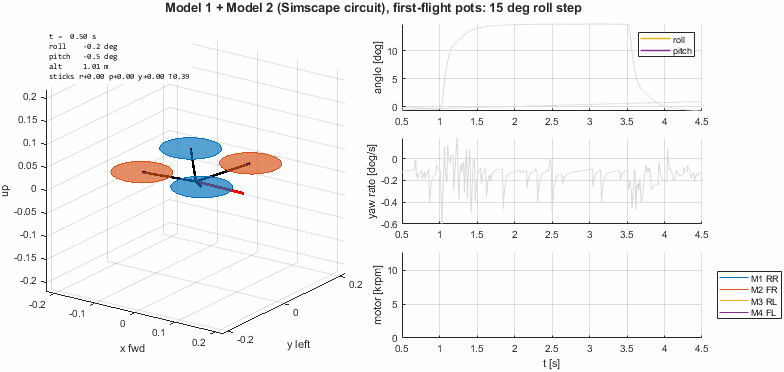
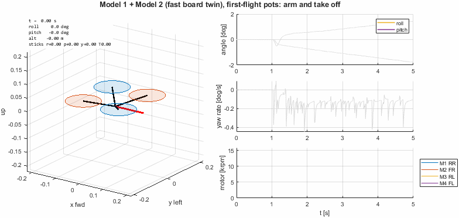
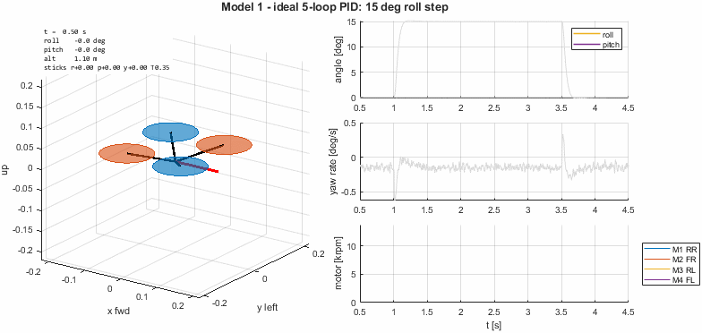
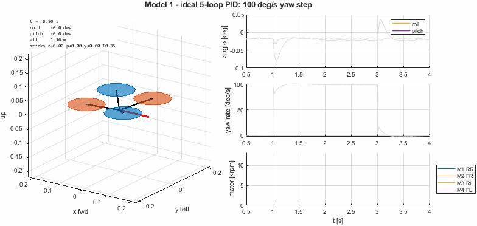
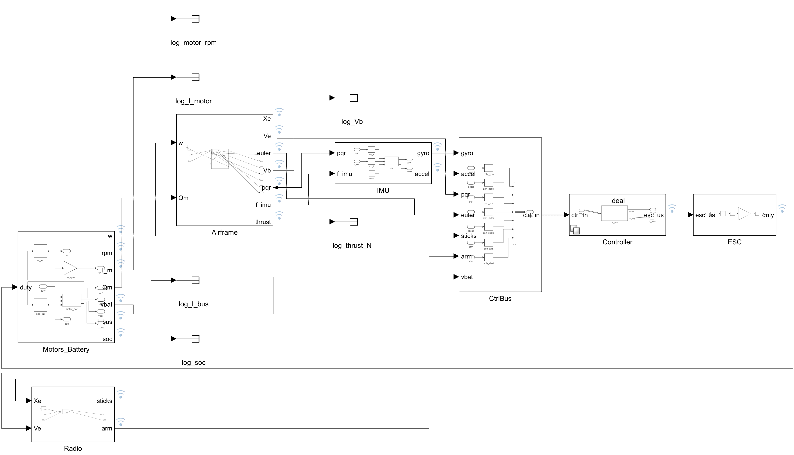
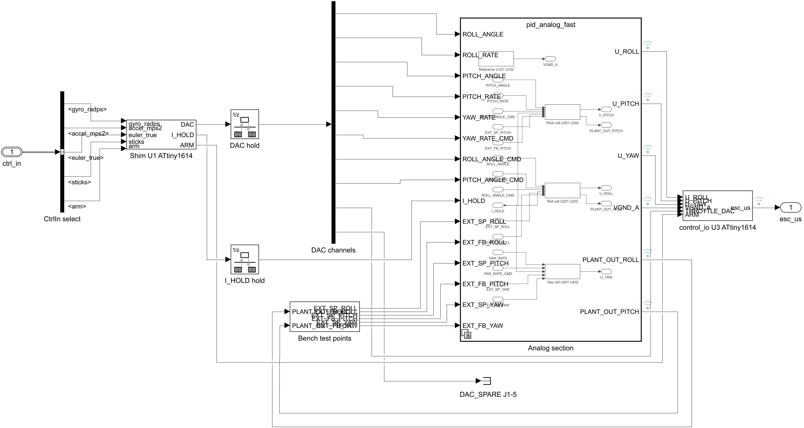
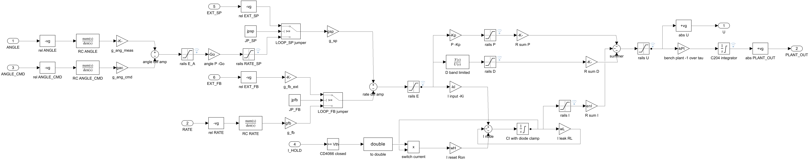
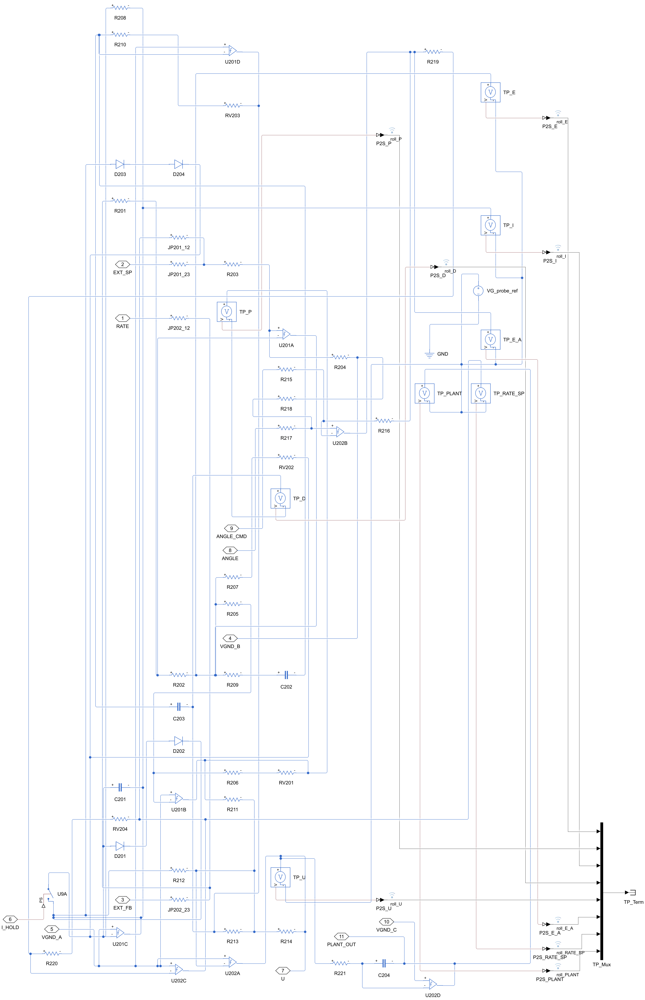

# Simulation: 5" quad + analog PID board twin

Two linked Simulink models (MATLAB R2024b):

| | Model | What it is for |
|---|---|---|
| **1** | [`quad_plant/quad_sim.slx`](quad_plant/) | The 5" quad itself: 6-DOF airframe, ESC, 2207 1800KV motors on 5x4.3x3 props, 4S battery with sag, MPU-6050 noise and delay. Has a controller slot. |
| **2** | [`pid_board/pid_board.slx`](pid_board/) | Digital twin of PID_Board rev B: shim (IMU, DAC), 5 analog loops, control_io (ADC, mixer, ESC pulses). The analog section comes in two variants: **fast** (behavioural, from component values) and **circuit** (Simscape Electrical, real op-amps, pots and diodes). |

Both honour one interface ([`common/quad_ctrl_buses.m`](common/quad_ctrl_buses.m)): bus `CtrlIn` in (gyro, accel, truth, sticks, arm, vbat) → `esc_us` [4×1] out. The controller slot in Model 1 (`qsim.ctrl`) can hold:

1. `ideal`: an idealised 5-loop cascaded PID with the board's loop shape ([`quad_plant/ctrl_ideal.slx`](quad_plant/)), used to learn gains
2. `board_fast`: Model 2 with the fast analog section
3. `board_circuit`: Model 2 with the Simscape circuit

Model 2 also runs standalone on a bench harness (`pid_board/pid_board_bench.slx`), driving the LOOP/GYRO jumper bench modes. You can compare it against scope traces on the real board's test points.

## The board twin flying the quad

| Simscape circuit model, first-flight pots | Fast board model, arm and take off |
|---|---|
|  |  |

The slow roll creep in the takeoff GIF (about 0.35 °/s) is the assumed shim angle estimator, not the analog loops. See [Known gaps](#known-gaps--to-confirm-on-the-real-hardware).

**First-flight pots** ([`gains/first_flight_gains.md`](gains/first_flight_gains.md)), 15° steps and hover:

| Controller in the slot | Roll step | Pitch step | Yaw 100 °/s step | Hover attitude rms | Takeoff max tilt |
|---|---|---|---|---|---|
| Ideal PID (same gains) | 0% OS, 0.45 s | 0.2% OS, 0.46 s | 2.7% OS, 0.07 s | 0.04° | 0.7° |
| Board twin, fast | 0% OS, 0.55 s | 4.2% OS, 0.41 s | 14% OS, 0.07 s | 2.6° / 1.7° | 2.1° |
| Board twin, circuit | 0% OS, 0.56 s | 4.0% OS, 0.41 s | 12% OS, 0.07 s | 2.6° / 1.7° | 2.1° |
| Board twin, fast, true angles instead of the shim's estimate | 0% OS, 0.47 s | | | 0.05° | |

OS = overshoot; times are 5% settling. The fast and circuit models agree closely. The extra error against the ideal PID comes from two places:
- **Board timing:** the board's 400 Hz control_io frame and the DAC/ADC quantisation slow the loops slightly.
- **Shim estimator:** the angle estimate is an assumption, since no firmware exists yet. The last row isolates it: with true angles, hover error drops from 2.6° to 0.05°.

## Model 1 alone (ideal controller)

| | |
|---|---|
|  |  |

- **Hover:** 1389 µs (39% duty) on a full pack; rpm and current match the thrust-stand data.
- **Aggressively tuned gains:** 15° steps settle in 0.13 s with about 1% overshoot. Several of those values fall outside the board's pot ranges. See [`pid_board/README_model2.md`](pid_board/README_model2.md) for part changes that bring them in range.
- **Robustness** (`quad_plant/robustness_sweep.m`): wrong inertia is harmless, but CG offset matters. Keep the CG within about 5 mm of the motor centre, because the board's leaky integrators can't fully trim a constant torque.
- **Battery:** sag of 3.1 V on a full-throttle punch. Over 4 minutes, hover throttle creeps 1389 → 1417 µs.
- **ESC warning:** a full-throttle punch draws about 30 A per motor (119 A total). The Aero Selfie 4in1 is rated 10 A continuous per channel.

## Screenshots

| Model 1 top level | Board twin top level |
|---|---|
|  |  |
| **Fast roll cell (U201/U202)** | **Circuit roll sheet (Simscape)** |
|  |  |

More in [`docs/img/`](docs/img/):
- **Model 1:** airframe, motors and battery, IMU, ideal controller
- **Board:** shim, control_io, bench harness
- **Fast analog model:** top level and yaw cell
- **Circuit model:** top level, yaw sheet, reference, DAC RC filters

## Quick start

```matlab
cd sim/quad_plant
quad_sim_params                      % quad, ideal gains, CtrlIn bus, sim options
M = run_quad_scenarios();            % hover, steps, punch, takeoff, battery drain (+ plots)

addpath ../gains ../pid_board
FF = first_flight_gains('apply', true);   % conservative pots + mixer scales into pcb / ideal
qsim.ctrl = 2;                       % fly the board twin (3 = Simscape circuit)
M = run_quad_scenarios({'roll_step','takeoff'});

cd ../pid_board
pid_board_validate                   % stage gains, rails, clamp, I_HOLD, disarm, closed loop

cd ../docs
make_flight_gif('roll_step', 'img/my_run.gif', 'ctrl', 2)
```

## Layout

| Folder | Contents |
|---|---|
| [`quad_plant/`](quad_plant/) | Model 1, parameters (`quad_params.m` + sources), scenarios, tuning, robustness sweep. [README](quad_plant/README_model1.md) |
| [`pid_board/`](pid_board/) | Model 2: spec extracted from the KiCad schematics, `pcb` parameters, fast and circuit analog sections, board model, bench harness, validation, pot↔gain conversion. READMEs: [board](pid_board/README_model2.md), [circuit](pid_board/README_circuit.md), [analog interface](pid_board/ANALOG_INTERFACE.md) |
| [`gains/`](gains/) | First-flight (conservative) trimpot settings and how they were chosen |
| [`common/`](common/) | Interface contract (`CtrlIn` bus, conventions) |
| [`docs/`](docs/) | Screenshots, GIFs and the GIF generator |
| [`legacy_roll_axis/`](legacy_roll_axis/) | The original roll-axis-only model, superseded by Model 2. Note: its `build_roll_model.m` never wires the angle-command inport; `pid_board_validate` patches a temporary copy. |

## Conventions

- Body axes: x forward, y right, z down. Roll right, nose up and nose right are positive.
- Motors (Betaflight Quad-X, seen from above): M1 rear-right CW, M2 front-right CCW, M3 rear-left CCW, M4 front-left CW.
- Sticks: roll, pitch and yaw in [-1, 1], throttle in [0, 1]. Pitch +1 = stick forward = nose down.

## Known gaps / to confirm on the real hardware

- **No firmware exists yet for the shim (U1) or control_io (U3).** Every firmware behaviour is an assumption and a `pcb` field. See `pid_board/pid_board_spec.md` section 8.
  - **Shim:** 1 kHz loop, gyro scale 6 mV per °/s (the breadboard sketch used 8.19), ±60° and ±250 °/s stick scales.
  - **control_io:** 400 Hz PWM ESC output, 10-bit ADC on VDD, Betaflight motor order, per-axis mixer scale (`pcb.ctrl.K_rpy`, first-flight values in `gains/`).
- **Angle estimator:** a complementary filter with α = 0.98 (τ = 50 ms) diverges in flight, because the accelerometer measures thrust, not gravity. The model uses α = 0.99995 (τ = 20 s), which works but turns gyro bias into a slow angle drift.
  - The real firmware should estimate gyro bias (for example a Mahony filter) or trust the accelerometer only when |a| ≈ 1 g.
- **Physical numbers to measure:** weigh the quad, find the CG, run a bifilar pendulum for inertia, log hover throttle. CAD mass properties can replace the estimates in `quad_params.m`.
- **Simscape circuit accuracy:** inside the 0.5 ms quad sim it's accurate to about 50 Hz. Use `pacirc.Ts = 20e-6` in the standalone test rigs for D-kick and rail detail.
- **ESC current rating** vs about 30 A peak per motor.
